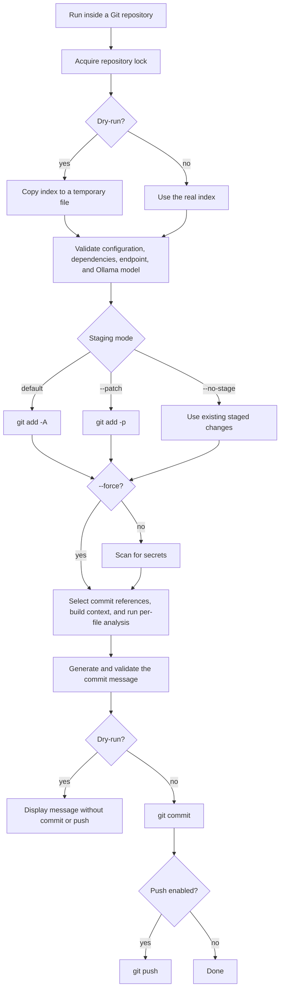

<div align="center">

# Git Auto Commit Ollama

[](https://github.com/aibersemi/git-auto-commit-ollama/actions/workflows/ci.yml)


[](https://saweria.co/aibersemi)

</div>

A Bash CLI that generates Git commit messages with a model available on an
Ollama server.

By default, `git-ai` checks the Ollama endpoint and model, runs `git add -A`,
scans staged changes, requests an English Conventional Commit message, creates
the commit, and pushes it. Change context is sent to the configured Ollama
endpoint, which may run locally or on another network host.

## Table of Contents

- [Features](#features)
- [How It Works](#how-it-works)
- [Commit References](#commit-references)
- [Prerequisites](#prerequisites)
- [Installation](#installation)
- [Configuration](#configuration)
- [Usage](#usage)
- [Dry Run](#dry-run)
- [Security](#security)
- [Troubleshooting](#troubleshooting)
- [Development](#development)
- [Repository Structure](#repository-structure)
- [Contributing](#contributing)
- [Support](#support)
- [License](#license)

## Features

- Automatic staging with `git add -A`, interactive staging with `git add -p`,
  or reuse of the existing index with `--no-stage`.
- Ollama preflight through `/api/tags`, `/api/ps`, and `/api/chat`, including a
  fallback host, automatic model pulling, and model warm-up before staging.
- Scope-free Conventional Commit messages through Ollama `/api/chat`.
- JSON Schema structured output with plain-text fallback and bounded corrective retries; generation failure stops before committing or pushing.
- Per-file diff analysis with configurable file-count, blob-size, and adaptive
  Ollama concurrency limits, with incremental progress for each completed file.
- Adaptive non-AI concurrency for independent read-only context jobs.
- Prompt prioritization for capabilities, APIs, data integrity, security, and
  user flows; generated artifacts are treated as supporting context.
- Combined runtime and informative Markdown references, with full-diff
  ranking and bounded excerpts of the most informative changed hunks.
- Required Gitleaks scanning of staged additions to block commits with potential
  secrets, unless `--force` is explicitly selected.
- Safe mode that withholds sensitive diff details from prompts unless the user
  explicitly selects `--force-diff` or `--force`.
- Push to an existing upstream, or `git push -u` to `origin` or the first
  remote when the branch has no upstream.
- Dry-run with a temporary index so staging, commits, and pushes do not
  permanently change Git state.
- A per-repository lock that prevents concurrent `git-ai` processes.
- Script messages, help text, prompts, and generated commit messages in
  English. Output from Git, Ollama, or other tools uses each tool's own
  language.

## How It Works



The message uses the scope-free Conventional Commit format:

```text
<type>: <summary>
```

For exactly one staged file, the message contains only the subject. For more
than one staged file, the message must contain one blank line followed by one
to six important bullet points. Accepted types are `build`, `chore`, `ci`,
`deps`, `docs`, `feat`, `fix`, `perf`, `refactor`, `revert`, `style`, and
`test`.

Choose the type that describes the primary change:

| Type | Use when the primary change... |
| --- | --- |
| `build` | Changes the build system, build scripts, compilers, bundlers, packaging, or other build tooling. |
| `chore` | Performs routine maintenance that does not fit another type and does not change product behavior. |
| `ci` | Changes CI/CD workflows, pipeline configuration, or automation scripts used by CI/CD. |
| `deps` | Adds, removes, or updates dependencies or their lockfiles. |
| `docs` | Changes documentation only. |
| `feat` | Adds a new user-facing, API, or domain capability. |
| `fix` | Corrects a bug or unintended behavior. |
| `perf` | Improves performance without changing the intended behavior. |
| `refactor` | Restructures production code without adding a feature or fixing a bug. |
| `revert` | Undoes a previous commit or change. |
| `style` | Changes code formatting, whitespace, or other non-behavioral style details only. |
| `test` | Adds, corrects, or improves tests without changing production behavior. |

If dependency, test, documentation, generated artifact, or configuration
changes only support a more important feature or fix, use `feat` or `fix` for
the primary change instead of the supporting type.

### Commit References

Runtime source establishes implemented behavior, corroborated by informative
staged `.md` changes. The tool reads the index, including its temporary
dry-run index; `--no-stage` ignores unstaged changes. Extension matching is
case-insensitive. Documentation, tests, CI, and generated artifacts are
classified before runtime path keywords: `docs/security.md` and recovery
tests do not imply a functional security change. Templates, stylesheets,
source code, and runtime configuration can be primary runtime changes.

The Markdown heuristic evaluates the complete eligible diff before excerpt
truncation. It ignores Git headers, empty lines, Markdown headings and
formatting markers, and lines containing only a URL or link. After case,
punctuation, and whitespace normalization, Markdown qualifies with at least
12 added words and 8 net-new word occurrences. Net-new occurrences subtract
removed occurrences per word. Qualified Markdown is ordered by net-new
count; runtime files use changed-line count. Path breaks score ties.

When both runtime and informative Markdown are available, the first two
references are one runtime file and one Markdown file (`mixed` mode).
Remaining runtime files follow, then remaining informative Markdown, then
supporting files. `TOP_FILES=1` selects runtime. Per-file analysis follows
the same order within `FILE_ANALYSIS_LIMIT`. Documentation-only work still
uses short edits, deletions, and renames when no Markdown qualifies. With
no eligible excerpts, generation uses Git metadata.

Within each file, complete hunks are ranked by Markdown text changes or
runtime changed-line count. Up to four hunks are compacted by placing additions before removals and retaining up to three unchanged source conditions or return statements. Other unchanged context is removed. Context lines keep their space prefix so existing alternatives remain distinguishable from new behavior. Long lines and
excerpts are bounded without splitting Unicode characters. Paired prose
removes shared prefixes/suffixes with a small context margin; long source
hunks sample changed lines across their beginning, middle, and end. Primary context
shares the existing total budget across selected files, including labels,
so supporting content cannot consume the space reserved for runtime.

Generated or ephemeral paths, binary diffs, oversized staged blobs, and
detected sensitive files are excluded. The complete diff is checked for
sensitive patterns before any ranking or truncation. Safe mode withholds
primary diffs and permits only eligible safe per-file summaries. If runtime
changes have no eligible source excerpts, output reports limited context;
the prompt must not infer unsupported behavior from supporting documents.
`--no-file-analysis` preserves direct excerpts, which also remain available
when analysis fails or returns a generic summary.

All staged files remain in classification and metadata, subject to display
limits. Documentation-only work uses `docs`; tests without runtime changes
use `test`; CI without runtime changes uses `ci` and takes priority over
supporting tests. With runtime changes, the head and first bullet must explain
implemented behavior, with documentation, tests, and CI afterward. Category
checks and language patterns reject supporting themes and request a
corrective retry, including contribution/security guidelines or requirements
to run a regression suite.

Runtime rules about test credentials or fixture inputs remain runtime work; adding tests or maintaining test fixtures is supporting work. Rejections identify the commit type, subject, or first bullet, with a diagnostic code and the offending text when applicable. Per-file analysis compares accepted inputs before and after validation changes and treats unchanged conditions as existing behavior.

Generation has a total limit of 10 attempts and a separate limit of three invalid commit-message responses, including format and quality failures. Unavailable requests consume the total attempt budget without consuming the invalid-response budget. JSON Schema composition failures consume the invalid-response budget and try plain text within the same attempt when that budget permits. Corrective prompts preserve the response format required by the active system prompt. Exhausting either budget exits with an error before commit or push and preserves staged changes; every emitted commit message must pass validation.

Ranking measures changed text, not semantic relevance or implementation
correctness. Classification and language checks cannot prove the accuracy
of a generated message. Prompts treat repository contents, including
`AGENTS.md`, as change data rather than instructions and describe completed
work only. Review the message against the actual changes. Reference selection
does not require an additional AI request.

The default limit for the entire message is 65,536 characters and can be
changed with `MAX_COMMIT_MESSAGE_LENGTH`. The script does not enforce a
72-character or 120-character subject limit.

## Prerequisites

The runtime targets Linux with Bash and GNU userland. These commands are
checked explicitly at startup:

- `git`
- `curl`
- `jq`
- `flock` from the `util-linux` package
- `gitleaks` with support for `git --pre-commit --staged`, JSON reports, and
  `--exit-code` (validated with version `8.30.1`)

The script also uses standard utilities such as `grep` with PCRE support,
`sed`, `head`, `sort`, `mktemp`, `date`, and `wc`. An Ollama server must be
reachable from the host running the CLI.

Optional dependencies:

- `make` and `sudo`: Required by the `Makefile` install and uninstall targets.
- `ollama`: Required only for automatic pulling when `DEFAULT_MODEL` is
  missing from the server.
- `shellcheck`: Bash linting during development and in CI.
- `tput`: Terminal dimensions for animated loading rows; when unavailable,
  dimensions use `COLUMNS`/`LINES` or fall back to 80 columns and 24 rows.

Example runtime and development installation on Ubuntu or Debian:

```bash
sudo apt-get update
sudo apt-get install -y bash git curl jq util-linux coreutils grep sed make shellcheck
```

Install Gitleaks from the [official releases](https://github.com/gitleaks/gitleaks/releases)
or follow its [installation instructions](https://github.com/gitleaks/gitleaks#installing).
Distribution packages may lag behind the supported command interface. Confirm
`gitleaks version` and `gitleaks git --help` before running `git-ai`. Gitleaks
is required at startup even when `--force` skips scanning.

For a local Ollama instance, start the service and install the configured
default model:

```bash
ollama serve
ollama pull gemma4:e4b
```

If Ollama runs on another host and the model is already available there, the
`ollama` CLI does not need to be installed locally.

## Installation

Clone the repository:

```bash
git clone https://github.com/aibersemi/git-auto-commit-ollama.git
cd git-auto-commit-ollama
```

Run the script directly without installing it:

```bash
./git-ai.sh --version
./git-ai.sh --help
```

To create a `git-ai` command in `/usr/local/bin`:

```bash
make install
```

The `install` target uses `sudo` and creates `git-ai` and `git-ai.conf`
symlinks in `$(PREFIX)/bin`. Both symlinks point to the current repository
checkout, so the cloned directory must remain in the same location.

Use `PREFIX` to install elsewhere:

```bash
make install PREFIX="/opt/git-ai"
```

Uninstall with the same `PREFIX` used during installation:

```bash
# Default installation
make uninstall

# Installation with a custom PREFIX
make uninstall PREFIX="/opt/git-ai"
```

## Configuration

The primary configuration is in [`git-ai.conf`](git-ai.conf). The script first
looks for `git-ai.conf` next to the executable path that was invoked. If the
executable is a symlink and no adjacent configuration exists, it looks next to
the resolved script target. Changes to the checkout configuration therefore
remain effective when only the `git-ai` symlink is invoked. `make install`
still creates both symlinks in the same destination directory.

The configuration file is sourced as shell code rather than parsed as a data
format. Treat it as trusted code and do not store secrets in it.

Current `git-ai.conf` values:

| Variable | Default | Purpose |
| --- | --- | --- |
| `DEFAULT_MODEL` | `gemma4:e4b` | Ollama model used unless `-m/--model` temporarily overrides it. |
| `DEFAULT_OLLAMA_HOST` | `http://127.0.0.1:11434` | Primary Ollama host. |
| `FALLBACK_OLLAMA_HOST` | `http://10.50.0.2:11434` | Fallback host when the primary `/api/tags` request fails. Clear it when unused. |
| `DEFAULT_DO_PUSH` | `1` | Push automatically after committing. |
| `AI_TEMPERATURE` | `0.2` | Model request temperature. |
| `AI_THINK` | `false` | `think` value: `false`, `true`, `low`, `medium`, or `high`. |
| `AI_NUM_PREDICT` | `512` | Output token limit for the primary request. |
| `AI_MAX_NUM_PREDICT` | `2048` | Upper `num_predict` limit for primary and per-file requests. |
| `USE_STRUCTURED_OUTPUT` | `0` | Use JSON Schema (`1`) or plain text (`0`). Disabled by default because `gemma4:e4b` does not consistently follow structured output. |
| `MAX_COMMIT_MESSAGE_LENGTH` | `65536` | Maximum length of the entire commit message. |
| `FILE_ANALYSIS_LIMIT` | `6` | Maximum files selected for per-file analysis; `0` disables those requests. |
| `FILE_ANALYSIS_BATCH_SIZE` | `1` | Compatibility option accepting a positive integer; requests always contain one file, including when this value is larger than `1`. |
| `FILE_ANALYSIS_PARALLELISM` | `auto` | Maximum concurrent per-file analysis requests. `auto` reads `OLLAMA_NUM_PARALLEL` from a local systemd service, then the local process environment, and uses capacity `1` when neither provides a valid value. |
| `FILE_ANALYSIS_NUM_PREDICT_PER_FILE` | `192` | Output-token budget allocated to each file analysis. |
| `FILE_ANALYSIS_MAX_BLOB_BYTES` | `1048576` | Maximum staged blob size eligible for commit reference excerpts and per-file AI analysis. |
| `NON_AI_PARALLELISM` | `auto` | Maximum workers for independent local read-only jobs. `auto` uses the logical CPU capacity available to the process. |
| `OLLAMA_PARALLELISM_HINT` | empty | Optional positive-integer capacity hint when a remote, containerized, or custom Ollama service cannot be inspected. |
| `MAX_FILES_LIST` | `20` | Entry limit for file status and Git statistics context. |
| `TOP_FILES` | `4` | Maximum primary reference files included in hunk summaries. |
| `MAX_HUNK_CHARS` | `1000` | Per-file hunk character limit. |
| `MAX_TOTAL_HUNKS_CHARS` | `3500` | Total hunk character limit in the primary prompt. |

Ollama host resolution follows this order:

1. Use `DEFAULT_OLLAMA_HOST` when it is not empty.
2. Otherwise, read `OLLAMA_HOST` from the active `ollama.service` environment,
   with `/etc/systemd/system/ollama.service` as a fallback.
3. Fall back to `http://localhost:11434`.

`FALLBACK_OLLAMA_HOST` is attempted only when the primary `/api/tags` check
fails. The active host is then used for model checks, warm-up, diff analysis,
and commit message generation.

Parallelism is a capacity, not a request target. Local non-AI jobs use at most
`NON_AI_PARALLELISM` workers and never overlap staging, the secret-policy
decision, commit creation, or pushing. Per-file AI analysis uses at most the
resolved Ollama capacity and the number of selected files. Selected files are
sent in separate requests. With capacity `4`, three files use three requests
in parallel; six files start four requests and fill freed worker slots with
the remaining files. With effective capacity `1`, each request runs in the
foreground and finishes before the next starts; only the loading renderer
runs in the background. One request per file adds request overhead but allows
incremental file progress. Terminal output shows the detected
capacity and its source, active workers, and a separate animated row for each
active file. Capacity is resolved after the active endpoint is selected.
A numeric `FILE_ANALYSIS_PARALLELISM` takes precedence over
`OLLAMA_PARALLELISM_HINT`, local service detection, the local process
environment, and the conservative fallback, in that order. Completed results
retain reference order in the final prompt.
Ollama does not expose its parallelism setting through its public API, so
remote endpoints should set `OLLAMA_PARALLELISM_HINT` or use a numeric
`FILE_ANALYSIS_PARALLELISM`.

The terminal progress bar is a simulated estimate, marked `est.` while AI work
is running. It starts at `0%`, advances by one point every 100 milliseconds,
and stops at `95%` while waiting. Starting or completing a request does not jump
the percentage. The same clock continues from per-file analysis into final
commit-message generation and across retries, so changing phases never resets
the bar. The file counter advances once for each completed file, from `0/6`
through `1/6`, `2/6`, and finally `6/6` for six selected files. Result lines
retain `[n/total]` counters even when responses finish together or out of order.
Failed or incomplete responses also advance the counter once and are marked
`(local fallback)`. Active files retain separate animated rows. Progress reaches
`100%` only after the final commit message is available. The spinner and
elapsed time continue updating at the waiting limit. Ollama responses are not
streamed, so the percentage improves visual feedback rather than measuring
model completion. Non-TTY output prints phase statuses and numbered file
results without animated frames or terminal control sequences.

Additional environment variables:

| Variable | Purpose |
| --- | --- |
| `NO_COLOR` | Disable color when non-empty; the TTY spinner remains active. |
| `EDITOR` | Editor for the `e` choice in `--interactive`; defaults to `vi`. |

## Usage

Run the command inside a Git repository with changes:

```bash
git-ai
```

The default workflow:

1. Validate the repository, configuration, dependencies, Ollama endpoint, and
   model.
2. Run `git add -A`.
3. Scan staged changes for potential secrets.
4. Generate and validate a commit message.
5. Run `git commit`.
6. Run `git push` when `DEFAULT_DO_PUSH=1`.

Example workflows:

```bash
# Commit without pushing
git-ai --no-push

# Stage interactively
git-ai --patch

# Confirm or edit the message before committing
git-ai --interactive

# Use changes that are already staged
git add git-ai.sh git-ai.conf
git-ai --no-stage

# Preview without permanent Git changes
git-ai --dry-run --no-push

# Preview with a temporary model override
git-ai --model gemma4:e4b --dry-run

# Display Git status without the Ollama preflight
git-ai --status
```

Available options:

| Option | Behavior |
| --- | --- |
| `-h`, `--help` | Display help. |
| `-v`, `--version` | Display the script version. |
| `-s`, `--status` | Run `git status` and exit. |
| `-n`, `--no-push` | Do not push after committing. |
| `-m MODEL`, `--model MODEL` | Temporarily use the selected Ollama model for this invocation without changing `git-ai.conf`. `--model=MODEL` is also supported. |
| `-p`, `--patch` | Use `git add -p` unless `--no-stage` is also selected. |
| `-i`, `--interactive` | Display the message and offer to continue, cancel, or edit before committing. |
| `--no-stage` | Use existing staged changes without automatic staging. |
| `-d`, `--dry-run` | Use a temporary index and skip the commit and push. |
| `--debug` | Display a detailed diagnostic trace, including runtime configuration, relevant commands and outputs, the full non-sensitive staged diff, complete prompts and request payloads, complete Ollama responses, HTTP metadata, and validation reasons. Safe mode omits sensitive diff content unless `--force-diff` or `--force` is explicitly selected. |
| `--force-diff` | Send detailed diffs to Ollama even when sensitive patterns are detected. |
| `-f`, `--force` | High-risk override: skip Gitleaks scanning, disable safe mode, and allow sensitive diff context to reach Ollama. |
| `-a`, `--allow-secret-commit` | Allow a commit when the secret guard finds a potential secret. |
| `--no-file-analysis` | Disable per-file AI analysis. |
| `--file-analysis-limit N` | Limit analyzed files; accepts a non-negative integer. |
| `--file-analysis-batch-size N` | Compatibility option; accepts integers of at least `1`, while effective request size remains one file. |
| `--file-analysis-parallelism N\|auto` | Set concurrent file-analysis request capacity or detect it from a local Ollama service. |
| `--non-ai-parallelism N\|auto` | Set local worker capacity or use the available logical CPU count. |
| `--no-structured` | Skip JSON Schema and use plain text, including when `USE_STRUCTURED_OUTPUT=1`. Without this option, a structured response containing plain commit text is retried as plain text; if still invalid, the request falls back to plain text within the same attempt. |
| `--no-pull` | Fail when the model is unavailable without running `ollama pull`. |
| `--no-banner` | Hide the startup banner. |
| `--no-verify` | Run `git commit --no-verify`; pre-push hooks still run during push. |

Use `DEFAULT_MODEL` in `git-ai.conf` for the persistent default. A command-line
`-m/--model` value has priority only for the current invocation and is used for
model availability checks, optional pulling, warm-up, analysis, and commit
message generation.

## Dry Run

`--dry-run` copies the Git index to a temporary file and performs staging and
analysis against that copy. It does not change the original index, create a
commit, or push. The temporary index file and repository lock are removed when
the process exits.

Dry-run is not an offline mode. Preflight and generation requests still contact
Ollama, model warm-up still runs, and a missing model may be pulled when the
`ollama` CLI is available. Add `--no-pull` when a preview must not install a
new model:

```bash
git-ai --dry-run --no-push --no-pull
```

If the secret guard finds a potential secret during dry-run, the script warns
the user and continues generating a preview without committing or pushing.

## Security

Context sent to Ollama may include file names, statuses, statistics, Git
summaries, diff excerpts, and per-file analysis requests. Use a local or trusted
network endpoint, and review `DEFAULT_OLLAMA_HOST` and
`FALLBACK_OLLAMA_HOST` before running the tool on a sensitive repository.

Available protections:

- Gitleaks is the sole scanner that determines commit blocking. It scans
  staged additions with `gitleaks git --pre-commit --staged --redact`, using
  JSON reports and a dedicated findings exit code. Findings display only the
  file, line number, and rule ID. Reports are held in a private temporary
  directory and removed after processing; raw scanner logs are not printed,
  including with `--debug`.
- A missing Gitleaks executable stops startup. Scanner errors, unsupported
  flags, invalid configuration, or missing/invalid reports stop the run before
  generation, commit, and push. `--dry-run`, `--allow-secret-commit`, and
  `--force-diff` cannot bypass a failed scan. `--force` explicitly skips scanning.
- Gitleaks uses its standard configuration and ignore mechanisms, including
  `.gitleaks.toml`, `GITLEAKS_CONFIG`, `GITLEAKS_CONFIG_TOML`, `.gitleaksignore`,
  and `gitleaks:allow` comments. Review custom rules and exclusions because they
  affect which findings can block commits. Gitleaks defaults may not detect
  generic passwords that the former built-in commit guard detected; use
  reviewed custom rules when those patterns must block commits.
- The built-in path-aware matcher protects AI context and does not independently
  block commits. The matching rules below describe this safe-mode matcher;
  its exemptions do not suppress Gitleaks findings. Files flagged by Gitleaks
  also activate safe mode and are excluded from references and per-file analysis.
  In Python and JavaScript/TypeScript files, unquoted function calls, environment lookups,
  and variable/member references are treated as expressions rather than
  credential literals. Quoted literals and unquoted configuration values
  remain checked at the existing 12-character threshold. Unknown file types
  receive no expression exemptions.
  Logical reference chains using `||` or `&&`, such as
  `env.POSTGRES_PASSWORD || ''`, are also source expressions. Each remaining
  operand is checked, so credential literals in fallbacks still trigger
  safe mode, even after empty strings or placeholder operands.
  Quoted expression text and configuration values receive no such exemption.
  Quoted names used as conditional branches, such as environment variable
  labels in ternary expressions, are not treated as property assignments.
  Placeholder exemptions apply to each value, not the whole line. Provider
  token and private-key signatures take precedence over all exemptions.
  Markdown (`.md`/`.mdx`) also applies source rules inside fenced code blocks
  explicitly labeled Python, JavaScript, or TypeScript (including `py`, `js`,
  `ts`, `jsx`, `tsx`, `mjs`, `cjs`, `mts`, and `cts`). Backtick and tilde fences
  are supported. The scanner reads complete staged Markdown diff context
  locally to recover fences outside edited hunks and tracks the old and new
  versions separately. AI excerpts retain their existing size limits.
  Prose, unlabeled fences, and configuration/shell fences remain conservative;
  credential literals and provider/private-key signatures remain scanned
  inside source examples. Test-only fixture exemptions do not apply to Markdown.
  Complete quoted source literals can also be placeholders when
  every hyphen/underscore-separated word belongs to a small placeholder
  vocabulary, includes a credential noun such as `key`, `token`, or
  `credential`, and either contains `synthetic`/`sintetis` or starts with
  `test`/`testing`/`tests`. The vocabulary includes `private`, `public`, and
  `auth`, covering labels such as `test-private-key`, `test-auth-key`, and
  `synthetic-api-key-for-tests`. A test suffix alone, arbitrary words, and
  random or numeric suffixes do not qualify. The exact OAuth example label
  `client-secret` is also a source placeholder. These exemptions do not apply to configuration values,
  unknown file types, unterminated strings, or concatenated expressions.
- Conventional Python and JavaScript/TypeScript test paths also recognize
  complete quoted fixture labels such as `test-google-token` and
  `RegressionPassword123!`. Token labels start with `test`, `testing`, or
  `tests`, followed by `google`, `github`, or `oauth` and `token`, optionally
  preceded by `access`, `auth`, or `refresh`; words use hyphens or underscores.
  Password labels start with `test` or `regression`, followed by `password`
  and the exact suffix `123`, with optional hyphens/underscores between words
  and an optional final `!`. Password lifecycle labels also qualify when they
  consist of `existing`, `previous`, or `new`, an optional `private` word,
  and `password`, separated by hyphens or underscores, such as
  `existing-private-password`. Matching is case-insensitive. These patterns
  apply only to source under `test/`, `tests/`, or `__tests__/`, Python
  `test_*.py`/`*_test.py` files (including `.pyi`), and JavaScript/TypeScript
  `*.test.*`/`*.spec.*` files. Other values in test files remain scanned.
  Production source, configuration files, arbitrary suffixes, unterminated
  strings, and concatenations remain protected. Full-diff checks require
  both paths of a rename to qualify. Provider/private-key signatures and
  independent `gitleaks` findings still take precedence.
- Complete quoted `*_SALT` literals in Python and JavaScript/TypeScript can represent public HMAC/signing namespaces, such as `PASSWORD_RESET_OTP_SALT` with the value `accounts.customer-password-reset-otp`. The value must be a dotted namespace of alphabetic words separated by hyphens or underscores, ending with the variable name without `_SALT` at a dot/hyphen/underscore boundary; hyphens and underscores are equivalent for this comparison. Arbitrary salt values, other credential names, configuration files, unterminated strings, and concatenations do not receive this exemption. Lint suppression comments do not affect scanning. Provider and private-key signatures still take precedence, and `gitleaks` findings remain independent.
- During a normal run, a secret finding cancels the commit.
  `--allow-secret-commit` only bypasses that cancellation.
- Safe mode removes detailed diffs from the primary prompt and skips sensitive
  files during per-file analysis. Git metadata and diffs from other files not
  detected as sensitive may still be sent.
- Commit reference excerpts and per-file AI analysis exclude generated and
  ephemeral paths, binary diffs, and staged blobs larger than
  `FILE_ANALYSIS_MAX_BLOB_BYTES`. The primary prompt still contains bounded
  Git metadata for the overall change.
- `--allow-secret-commit` does not disable safe mode. Use `--force-diff`
  separately only when sending a sensitive diff is intentional.
- `--force-diff` does not allow a commit blocked by the secret guard.
- `--force` skips secret scanning, disables safe mode, and permits sensitive
  diff context to be sent to Ollama. It is not equivalent to combining
  `--allow-secret-commit` and `--force-diff`, which still performs the scan.
- `--no-push`, `--no-stage`, and `--dry-run` each protect a different Git
  operation boundary and are not interchangeable.

Secret detection is best effort and may produce false positives or false
negatives. Do not stage credentials, private keys, tokens, or environment files
that must remain private.

See the [Security Policy](.github/SECURITY.md) for vulnerability reporting and
detailed scope.

## Troubleshooting

| Problem | Common cause | Solution |
| --- | --- | --- |
| `Ollama is unavailable ...` | The service is stopped, the host is wrong, or neither host is reachable. | Start or check Ollama and review `DEFAULT_OLLAMA_HOST` and `FALLBACK_OLLAMA_HOST`. |
| `DEFAULT_MODEL ... was not found` | The model is missing from the active host. | Pull the model on the server, install the `ollama` CLI for automatic pulling, or change `DEFAULT_MODEL`. |
| `Failed to load and verify model ...` | The model is listed, but the `/api/chat` readiness request failed or timed out. | Check Ollama logs, server resources, the model name, and connectivity to the active host. |
| `--no-stage ... there are no staged changes` | The index contains no changes. | Run `git add` first or remove `--no-stage`. |
| Commit canceled because of a potential secret | Gitleaks found a sensitive pattern in staged additions. | Remove the credential; use `--allow-secret-commit` only to bypass a reviewed finding. `--force-diff` only affects AI context, while `--force` skips scanning entirely. |
| Gitleaks missing or scan failed | Required executable unavailable, incompatible flags, invalid configuration, or an invalid/missing JSON report. | Install a compatible Gitleaks release and review scanner configuration. Finding overrides do not bypass scanner failures. |
| Commit hook failed | `pre-commit` or `commit-msg` rejected the commit. | Fix the hook finding; use `--no-verify` only when intentionally bypassing those commit hooks. |
| Pre-push hook failed | The hook was run by `git push`. | Fix the hook or use a separate push workflow; `git-ai --no-verify` is not forwarded to `git push`. |
| No remote exists | The repository has no remote. | The script skips the push; add a remote when pushing is required. |
| `git-ai` disappeared after moving the checkout | Installed symlinks still point to the old clone location. | Restore the checkout to its original location or reinstall from the new location. |
| Changes to `git-ai.conf` are ignored | The `git-ai` command and configuration come from different installations or checkouts. | Run `git-ai --help` to see the active configuration path, then inspect the symlink with `readlink -f "$(command -v git-ai)"`. |
| Output shows `Retry` | The Ollama request failed or the message failed format or quality validation. | Read the preceding rejection or availability message; use `--debug` for HTTP and format diagnostics. Quality feedback names the rejected part and sends the candidate and reason back to the model. Generation stops after three invalid responses or 10 total attempts, preserving staged changes without commit/push. Retry delays increase by one second, capped at 10 seconds. See [Commit References](#commit-references) for validation and retry behavior. |

Use `git-ai --debug` to inspect the active configuration and endpoint, relevant
Git and curl commands, command output, the full staged diff, complete prompts
and Ollama responses, HTTP timing, retries, validation reasons, and token
usage. Debug output can contain private source code, paths, repository metadata,
and model-generated text. Safe mode omits detected sensitive diff content, but
secret detection is best effort. Treat debug logs as sensitive and sanitize
them before storing or sharing. `--force-diff` explicitly permits the full diff
to appear in both prompts and debug output; `--force` does the same while also
skipping secret scanning.

## Development

Basic validation:

```bash
bash -n git-ai.sh
shellcheck git-ai.sh
./git-ai.sh --help >/tmp/git-ai-help.txt
bash -n tests/markdown-references.sh
shellcheck tests/markdown-references.sh
bash tests/markdown-references.sh
bash -n tests/secret-scanning.sh
shellcheck tests/secret-scanning.sh
bash tests/secret-scanning.sh
bash -n tests/gitleaks-integration.sh
shellcheck tests/gitleaks-integration.sh
bash tests/gitleaks-integration.sh
```

The [CI workflow](.github/workflows/ci.yml) runs these checks on pushes to
`main`, pull requests, and manual `workflow_dispatch` runs. The Markdown
reference and secret scanning regression suites use temporary local clones,
isolated indexes, and mocked Ollama responses. They create no new commits,
perform no pushes, and require no active Ollama endpoint. The secret scanning
suite also mocks Gitleaks and verifies blocking, scanner failures, safe previews,
expression/placeholder handling, and protection of removed/context lines. The
Gitleaks integration suite requires the installed binary and verifies real
staged scans, temporary indexes, redaction, overrides, and invalid configuration
in an isolated repository without Ollama, commits, or pushes.

For a runtime smoke test, use a temporary repository and dry-run. This command
still requires an active Ollama endpoint and an available model because
`--no-pull` is enabled:

```bash
project_dir=$(pwd -P)
test_repo=$(mktemp -d)
git init "$test_repo"
cd "$test_repo"
git config user.name "git-ai test"
git config user.email "git-ai-test@example.invalid"
printf 'hello\n' > sample.txt
"$project_dir/git-ai.sh" --dry-run --no-push --no-banner --no-pull
```

For a combined-reference runtime check, add a temporary `.md` file describing a
completed change in at least 12 words alongside a changed source file. Run
the same dry-run command and confirm that it reports runtime source and
informative staged Markdown, includes both in context, and leads the message
with the implemented behavior.
Use `--debug` to inspect the prompt if necessary, keeping logs private and
sanitized. Remove the temporary document afterward. Also verify non-Markdown
fallback with absent or cosmetic Markdown and compare the original index and
refs before and after each dry-run. Never create real commits or pushes for
these checks.

For per-file analysis performance changes, repeat the smoke test with six
small text files. Confirm that each request contains one file, that capacity
`1` runs AI requests in the foreground, and that larger capacities overlap
requests within the worker limit. Legacy batch-size values must still be
accepted without combining files. Measure the
`Analyzed ...` and `Commit message received ...`
durations with a warm model. Also test generated paths, binary files, and a
text blob larger than `FILE_ANALYSIS_MAX_BLOB_BYTES` to confirm they are
excluded from per-file requests.

For adaptive parallelism changes, also test numeric and `auto` values, a local
systemd Ollama service, a remote endpoint with `OLLAMA_PARALLELISM_HINT`, and
the conservative fallback. Confirm that result order is deterministic and
that effective concurrency never exceeds the number of ready jobs or files.
The regression suite measures overlapping requests and checks loading-row
refresh, estimated progress before results arrive, the 95% waiting limit,
completed-worker removal, every counter from `1/6` through `6/6`, and cursor
restoration. Also run a dry-run
in a terminal to inspect the animations and result output.

Do not run commit or push smoke tests in a primary working repository. See the
[Contributing Guide](.github/CONTRIBUTING.md) for the full workflow.

## Repository Structure

```text
.
|-- .github/
|   |-- CONTRIBUTING.md       # contribution guide
|   |-- SECURITY.md           # security policy and scope
|   `-- workflows/
|       |-- ci.yml            # syntax, ShellCheck, and help validation
|       |-- release.yml       # GitHub Releases for v* tags
|       `-- stale.yml         # stale issue and pull request management
|-- AGENTS.md                 # coding agent instructions
|-- Makefile                  # install or remove two symlinks
|-- README.md                 # primary usage documentation
|-- git-ai.conf               # default runtime configuration
`-- git-ai.sh                 # main CLI
```

## Contributing

Read the [Contributing Guide](.github/CONTRIBUTING.md) before opening a pull
request. For vulnerability reports, follow the
[Security Policy](.github/SECURITY.md) and do not send sensitive details
through a public issue.

## Support

If this project helps your workflow, you can support it through
[Saweria](https://saweria.co/aibersemi). For general usage questions, follow
the [Support Guide](.github/SUPPORT.md).

## License

This project uses the MIT License. See [`LICENSE`](LICENSE) for the complete
license text.
