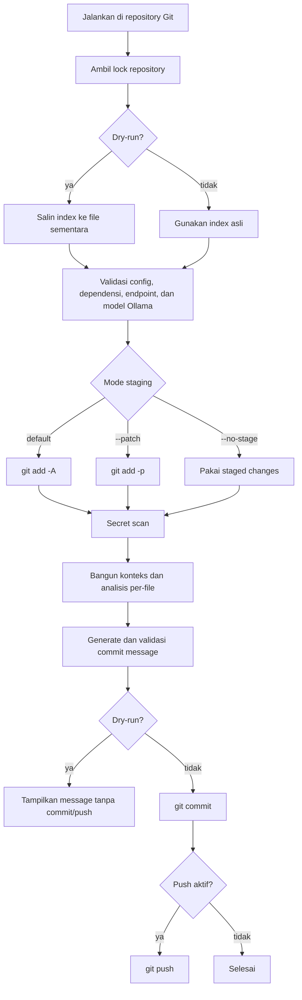

<div align="center">

# Git Auto Commit Ollama

[](https://github.com/aibersemi/git-auto-commit-ollama/actions/workflows/ci.yml)


[](https://saweria.co/aibersemi)

</div>

CLI Bash untuk membuat commit message Git dengan model yang tersedia di server Ollama.

Secara default, `git-ai` memeriksa endpoint dan model Ollama, menjalankan `git add -A`, memindai staged changes, meminta commit message Conventional Commit berbahasa Inggris, membuat commit, lalu melakukan push. Konteks perubahan dikirim ke endpoint Ollama yang dikonfigurasi; endpoint tersebut dapat berada di mesin lokal atau host jaringan lain.

## Table of Contents

- [Features](#features)
- [How It Works](#how-it-works)
- [Prerequisites](#prerequisites)
- [Installation](#installation)
- [Configuration](#configuration)
- [Usage](#usage)
- [Dry Run](#dry-run)
- [Security](#security)
- [Troubleshooting](#troubleshooting)
- [Development](#development)
- [Repository Structure](#repository-structure)
- [Contributing](#contributing)
- [Support](#support)
- [License](#license)

## Features

- Staging otomatis dengan `git add -A`, staging interaktif dengan `git add -p`, atau memakai index yang sudah di-stage melalui `--no-stage`.
- Preflight melalui Ollama `/api/tags`, `/api/ps`, dan `/api/chat`, termasuk fallback host, auto-pull model, dan warm-up model sebelum staging.
- Commit message Conventional Commit tanpa scope melalui Ollama `/api/chat`.
- Structured output berbasis JSON Schema dengan fallback plain text dan fallback message lokal jika respons AI tetap tidak valid.
- Analisis diff per-file secara paralel, dengan jumlah file dan paralelisme yang dapat diatur.
- Prioritas tema pada capability, API, integritas data, security, dan user flow; artefak generated diperlakukan sebagai konteks pendukung.
- Secret guard bawaan untuk baris staged yang ditambahkan, ditambah scan `gitleaks` jika command tersebut tersedia.
- Safe mode yang menahan diff sensitif dari prompt, kecuali pengguna memilih `--force-diff` secara eksplisit.
- Push ke upstream yang sudah ada, atau `git push -u` ke `origin`/remote pertama saat branch belum memiliki upstream.
- Dry-run dengan index sementara agar staging, commit, dan push tidak mengubah Git state secara permanen.
- Lock per repository untuk mencegah dua proses `git-ai` berjalan bersamaan.
- Pesan buatan script, help text, prompt, dan commit message menggunakan Bahasa Inggris. Output milik Git, Ollama, atau tool lain mengikuti tool tersebut.

## How It Works



Format message adalah Conventional Commit tanpa scope:

```text
<type>: <summary>
```

Untuk tepat satu staged file, message hanya berisi subject. Untuk lebih dari satu staged file, message harus memiliki satu baris kosong lalu 1-6 bullet penting. Tipe yang diterima adalah `feat`, `fix`, `refactor`, `docs`, `test`, `chore`, `build`, `ci`, `perf`, `style`, dan `revert`.

Batas default seluruh message adalah 65.536 karakter dan dapat diubah melalui `MAX_COMMIT_MESSAGE_LENGTH`. Script tidak menerapkan batas subject 72 atau 120 karakter.

## Prerequisites

Runtime ditujukan untuk Linux dengan Bash dan GNU userland. Command berikut diperiksa secara eksplisit saat startup:

- `git`
- `curl`
- `jq`
- `flock` dari paket `util-linux`

Script juga menggunakan utility standar seperti `grep` dengan dukungan PCRE, `sed`, `head`, `sort`, `mktemp`, `date`, dan `wc`. Selain itu, harus ada server Ollama yang dapat diakses dari host tempat CLI berjalan.

Dependensi opsional:

- `make` dan `sudo`: diperlukan oleh target install/uninstall pada `Makefile`.
- `ollama`: diperlukan hanya untuk auto-pull ketika `DEFAULT_MODEL` belum ada di server.
- `gitleaks`: scanner tambahan untuk staged changes.
- `shellcheck`: lint saat development dan di CI.

Contoh instalasi runtime dan development di Ubuntu/Debian:

```bash
sudo apt-get update
sudo apt-get install -y bash git curl jq util-linux coreutils grep sed make shellcheck
```

Untuk Ollama lokal, jalankan service dan sediakan model default:

```bash
ollama serve
ollama pull gemma4:e4b
```

Jika server Ollama berada di host lain dan model sudah tersedia di sana, `ollama` CLI tidak wajib terpasang secara lokal.

## Installation

Clone repository:

```bash
git clone https://github.com/aibersemi/git-auto-commit-ollama.git
cd git-auto-commit-ollama
```

Script dapat dijalankan langsung tanpa instalasi:

```bash
./git-ai.sh --version
./git-ai.sh --help
```

Untuk membuat command `git-ai` di `/usr/local/bin`:

```bash
make install
```

Target `install` menggunakan `sudo` dan membuat dua symlink, yaitu `git-ai` dan `git-ai.conf`, di `$(PREFIX)/bin`. Keduanya menunjuk ke checkout repository saat ini, sehingga direktori hasil clone harus tetap berada di lokasi yang sama.

Gunakan `PREFIX` untuk lokasi lain:

```bash
make install PREFIX="/opt/git-ai"
```

Uninstall harus memakai `PREFIX` yang sama dengan proses install:

```bash
# Instalasi default
make uninstall

# Instalasi dengan PREFIX khusus
make uninstall PREFIX="/opt/git-ai"
```

## Configuration

Konfigurasi utama berada di [`git-ai.conf`](git-ai.conf). Script mencari `git-ai.conf` di direktori yang sama dengan path executable yang dijalankan. `make install` memenuhi aturan ini dengan membuat symlink untuk script dan config pada direktori tujuan yang sama.

File config di-`source` sebagai shell code, bukan diparsing sebagai format data. Perlakukan file ini sebagai code tepercaya dan jangan menyimpan secret di dalamnya.

Nilai yang ada di `git-ai.conf` saat ini:

| Variabel | Default | Fungsi |
| --- | --- | --- |
| `DEFAULT_MODEL` | `gemma4:e4b` | Model Ollama yang dipakai; opsi model per-command tidak didukung. |
| `DEFAULT_OLLAMA_HOST` | `http://127.0.0.1:11434` | Host Ollama utama. |
| `FALLBACK_OLLAMA_HOST` | `http://10.50.0.2:11434` | Host cadangan saat request `/api/tags` ke host utama gagal. Kosongkan jika tidak digunakan. |
| `DEFAULT_DO_PUSH` | `1` | Push otomatis setelah commit. |
| `AI_TEMPERATURE` | `0.2` | Temperatur request ke model. |
| `AI_THINK` | `false` | Nilai `think`: `false`, `true`, `low`, `medium`, atau `high`. |
| `AI_NUM_PREDICT` | `2048` | Batas token output request utama. |
| `AI_MAX_NUM_PREDICT` | `2048` | Batas atas `num_predict` untuk request utama dan analisis file. |
| `MAX_COMMIT_MESSAGE_LENGTH` | `65536` | Panjang maksimal seluruh commit message. |
| `FILE_ANALYSIS_LIMIT` | `6` | Jumlah maksimum file yang dipilih untuk analisis per-file; `0` menonaktifkan request tersebut. |
| `FILE_ANALYSIS_PARALLELISM` | `4` | Jumlah request analisis file yang berjalan paralel. |
| `FILE_ANALYSIS_NUM_PREDICT_PER_FILE` | `512` | Target token output untuk setiap analisis file. |
| `MAX_FILES_LIST` | `20` | Batas entri pada konteks nama/status dan statistik Git. |
| `TOP_FILES` | `4` | Jumlah file terbesar yang dipilih untuk ringkasan hunk. |
| `MAX_HUNK_CHARS` | `1000` | Batas karakter hunk untuk setiap file terpilih. |
| `MAX_TOTAL_HUNKS_CHARS` | `3500` | Batas total karakter hunk pada prompt utama. |

Resolusi host Ollama mengikuti urutan berikut:

1. pakai `DEFAULT_OLLAMA_HOST` jika tidak kosong;
2. jika kosong, baca `OLLAMA_HOST` dari `/etc/systemd/system/ollama.service`;
3. jika tidak ditemukan, pakai `http://localhost:11434`.

`FALLBACK_OLLAMA_HOST` hanya dicoba saat pengecekan `/api/tags` ke host utama gagal. Host aktif kemudian dipakai untuk pengecekan model, warm-up, analisis diff, dan pembuatan commit message.

Environment variable tambahan yang digunakan:

| Variabel | Fungsi |
| --- | --- |
| `NO_COLOR` | Menonaktifkan warna saat nilainya tidak kosong; spinner TTY tetap aktif. |
| `EDITOR` | Editor untuk pilihan `e` pada `--interactive`; default `vi`. |

## Usage

Jalankan dari dalam repository Git yang memiliki perubahan:

```bash
git-ai
```

Alur default adalah:

1. memvalidasi repository, config, dependensi, endpoint, dan model Ollama;
2. menjalankan `git add -A`;
3. memindai staged changes untuk potensi secret;
4. membuat dan memvalidasi commit message;
5. menjalankan `git commit`;
6. menjalankan `git push` jika `DEFAULT_DO_PUSH=1`.

Contoh workflow:

```bash
# Commit tanpa push
git-ai --no-push

# Staging interaktif
git-ai --patch

# Konfirmasi atau edit message sebelum commit
git-ai --interactive

# Pakai staged changes yang sudah ada
git add git-ai.sh git-ai.conf
git-ai --no-stage

# Preview tanpa perubahan Git permanen
git-ai --dry-run --no-push

# Tampilkan status Git tanpa preflight Ollama
git-ai --status
```

Semua opsi yang tersedia:

| Opsi | Perilaku |
| --- | --- |
| `-h`, `--help` | Tampilkan help. |
| `-v`, `--version` | Tampilkan versi script. |
| `-s`, `--status` | Jalankan `git status` lalu keluar. |
| `-n`, `--no-push` | Jangan push setelah commit. |
| `-p`, `--patch` | Gunakan `git add -p`, kecuali `--no-stage` juga dipakai. |
| `-i`, `--interactive` | Tampilkan message dan tawarkan lanjut, batal, atau edit sebelum commit. |
| `--no-stage` | Pakai staged changes yang sudah ada tanpa staging otomatis. |
| `--dry-run` | Gunakan index sementara serta lewati commit dan push. |
| `--debug` | Tampilkan log debug. |
| `--force-diff` | Kirim diff detail ke Ollama walaupun pola sensitif terdeteksi. |
| `--allow-secret-commit` | Izinkan commit saat secret guard menemukan potensi secret. |
| `--no-file-analysis` | Nonaktifkan analisis AI per-file. |
| `--file-analysis-limit N` | Batasi file yang dianalisis; menerima bilangan bulat non-negatif. |
| `--file-analysis-parallelism N` | Atur request analisis paralel; minimal `1`. |
| `--no-structured` | Lewati JSON Schema dan gunakan respons plain text. |
| `--no-pull` | Gagal jika model belum tersedia, tanpa menjalankan `ollama pull`. |
| `--no-banner` | Sembunyikan banner awal. |
| `--no-verify` | Jalankan `git commit --no-verify`; pre-push hook tetap berjalan saat push. |

Opsi `-m`/`--model` sengaja ditolak. Ubah `DEFAULT_MODEL` di `git-ai.conf` untuk memilih model.

## Dry Run

`--dry-run` menyalin index Git ke file sementara, lalu melakukan staging dan analisis terhadap salinan tersebut. Mode ini tidak mengubah index asli, membuat commit, atau melakukan push. File index sementara dan lock repository dibersihkan saat proses selesai.

Dry-run bukan mode offline. Preflight dan request generasi tetap menghubungi Ollama, warm-up model tetap dijalankan, dan model yang belum tersedia dapat di-pull jika `ollama` CLI ada. Tambahkan `--no-pull` jika preview tidak boleh memasang model baru:

```bash
git-ai --dry-run --no-push --no-pull
```

Jika secret guard menemukan potensi secret pada dry-run, script menampilkan peringatan lalu melanjutkan pembuatan preview tanpa commit atau push.

## Security

Konteks yang dikirim ke endpoint Ollama dapat mencakup nama file, status, statistik, ringkasan Git, potongan diff, dan request analisis per-file. Gunakan endpoint lokal atau jaringan tepercaya, dan tinjau `DEFAULT_OLLAMA_HOST` serta `FALLBACK_OLLAMA_HOST` sebelum menjalankan tool pada repository sensitif.

Perlindungan yang tersedia:

- Secret guard bawaan memeriksa baris tambahan pada staged diff. Jika `gitleaks` tersedia, hasilnya ditambahkan ke pemeriksaan.
- Pada proses normal, temuan secret membatalkan commit. `--allow-secret-commit` hanya melewati pembatalan tersebut.
- Safe mode menghapus detail diff dari prompt utama dan melewati file sensitif pada analisis per-file; metadata Git dan diff file lain yang tidak terdeteksi sensitif masih dapat dikirim.
- `--allow-secret-commit` tidak menonaktifkan safe mode. Gunakan `--force-diff` secara terpisah hanya jika pengiriman diff sensitif memang disengaja.
- `--force-diff` tidak mengizinkan commit yang diblokir secret guard.
- `--no-push`, `--no-stage`, dan `--dry-run` menjaga batas operasi Git masing-masing dan tidak boleh diperlakukan sebagai sinonim satu sama lain.

Deteksi secret bersifat best effort dan dapat menghasilkan false positive maupun false negative. Jangan stage credential, private key, token, atau file environment yang seharusnya tetap privat.

Kebijakan pelaporan vulnerability dan detail scope tersedia di [Security Policy](.github/SECURITY.md).

## Troubleshooting

| Masalah | Penyebab umum | Solusi |
| --- | --- | --- |
| `Ollama is unavailable ...` | Service mati, host salah, atau kedua host tidak dapat diakses. | Jalankan/cek service Ollama dan periksa `DEFAULT_OLLAMA_HOST` serta `FALLBACK_OLLAMA_HOST`. |
| `DEFAULT_MODEL ... was not found` | Model belum ada pada host aktif. | Pull model ke server, pasang `ollama` CLI untuk auto-pull, atau ubah `DEFAULT_MODEL`. |
| `Failed to load and verify model ...` | Model terdaftar tetapi readiness request `/api/chat` gagal atau timeout. | Cek log Ollama, resource server, nama model, dan konektivitas ke host aktif. |
| `--no-stage ... there are no staged changes` | Index belum berisi perubahan. | Jalankan `git add` lebih dulu atau hapus `--no-stage`. |
| Commit dibatalkan karena potential secret | Secret guard bawaan atau `gitleaks` menemukan pola sensitif. | Hapus credential dari staged changes; gunakan override hanya setelah meninjau temuannya. |
| Commit hook gagal | `pre-commit` atau `commit-msg` menolak commit. | Perbaiki temuan hook; `--no-verify` melewati hook commit tersebut jika memang disengaja. |
| Pre-push hook gagal | Hook dijalankan oleh `git push`. | Perbaiki hook atau lakukan workflow push terpisah; `--no-verify` pada `git-ai` tidak diteruskan ke `git push`. |
| Tidak ada remote | Repository tidak memiliki remote. | Script melewati push; tambahkan remote jika push diperlukan. |
| `git-ai` hilang setelah checkout dipindah | Symlink install masih menunjuk ke lokasi clone lama. | Kembalikan checkout ke lokasi semula atau jalankan install ulang dari lokasi baru. |

Gunakan `git-ai --debug` untuk melihat endpoint aktif, model, ukuran payload, retry, dan penggunaan token. Jangan membagikan log tanpa memeriksa informasi internal di dalamnya.

## Development

Validasi dasar:

```bash
bash -n git-ai.sh
shellcheck git-ai.sh
./git-ai.sh --help >/tmp/git-ai-help.txt
```

CI pada [`.github/workflows/ci.yml`](.github/workflows/ci.yml) menjalankan tiga pemeriksaan yang sama pada push ke `main`, pull request, dan `workflow_dispatch`.

Untuk smoke test runtime, gunakan repository sementara dan dry-run. Command ini tetap membutuhkan endpoint Ollama yang aktif dan model yang sudah tersedia karena `--no-pull` digunakan:

```bash
project_dir=$(pwd -P)
test_repo=$(mktemp -d)
git init "$test_repo"
cd "$test_repo"
git config user.name "git-ai test"
git config user.email "git-ai-test@example.invalid"
printf 'hello\n' > sample.txt
"$project_dir/git-ai.sh" --dry-run --no-push --no-banner --no-pull
```

Jangan menjalankan smoke test commit/push pada repository kerja utama. Panduan kontribusi lengkap berada di [`.github/CONTRIBUTING.md`](.github/CONTRIBUTING.md).

## Repository Structure

```text
.
|-- .github/
|   |-- CONTRIBUTING.md       # panduan kontribusi
|   |-- SECURITY.md           # kebijakan dan scope keamanan
|   `-- workflows/
|       |-- ci.yml            # syntax, ShellCheck, dan help validation
|       |-- release.yml       # GitHub Release untuk tag v*
|       `-- stale.yml         # pengelolaan issue/PR stale
|-- AGENTS.md                 # instruksi kerja untuk coding agent
|-- Makefile                  # install/uninstall dua symlink
|-- README.md                 # dokumentasi penggunaan utama
|-- git-ai.conf               # default runtime config
`-- git-ai.sh                 # CLI utama
```

## Contributing

Baca [Contributing Guide](.github/CONTRIBUTING.md) sebelum membuka pull request. Untuk laporan vulnerability, ikuti [Security Policy](.github/SECURITY.md) dan jangan mengirim detail sensitif melalui issue publik.

## Support

Jika project ini membantu workflow Anda, dukungan bisa dikirim melalui [Saweria](https://saweria.co/aibersemi). Pertanyaan penggunaan umum juga dapat mengikuti [Support Guide](.github/SUPPORT.md).

## License

Project ini menggunakan MIT License. Lihat [`LICENSE`](LICENSE) untuk teks lisensi lengkap.
