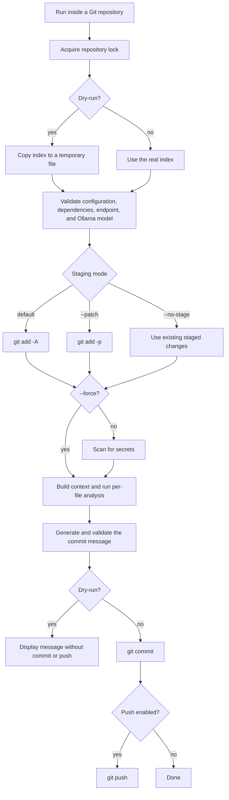

<div align="center">

# Git Auto Commit Ollama

[](https://github.com/aibersemi/git-auto-commit-ollama/actions/workflows/ci.yml)


[](https://saweria.co/aibersemi)

</div>

A Bash CLI that generates Git commit messages with a model available on an
Ollama server.

By default, `git-ai` checks the Ollama endpoint and model, runs `git add -A`,
scans staged changes, requests an English Conventional Commit message, creates
the commit, and pushes it. Change context is sent to the configured Ollama
endpoint, which may run locally or on another network host.

## Table of Contents

- [Features](#features)
- [How It Works](#how-it-works)
- [Prerequisites](#prerequisites)
- [Installation](#installation)
- [Configuration](#configuration)
- [Usage](#usage)
- [Dry Run](#dry-run)
- [Security](#security)
- [Troubleshooting](#troubleshooting)
- [Development](#development)
- [Repository Structure](#repository-structure)
- [Contributing](#contributing)
- [Support](#support)
- [License](#license)

## Features

- Automatic staging with `git add -A`, interactive staging with `git add -p`,
  or reuse of the existing index with `--no-stage`.
- Ollama preflight through `/api/tags`, `/api/ps`, and `/api/chat`, including a
  fallback host, automatic model pulling, and model warm-up before staging.
- Scope-free Conventional Commit messages through Ollama `/api/chat`.
- JSON Schema structured output with plain-text fallback and a local fallback
  message when the AI response remains invalid.
- Parallel per-file diff analysis with configurable file and concurrency limits.
- Prompt prioritization for capabilities, APIs, data integrity, security, and
  user flows; generated artifacts are treated as supporting context.
- A built-in secret guard for added staged lines, supplemented by `gitleaks`
  when the command is available, unless `--force` is explicitly selected.
- Safe mode that withholds sensitive diff details from prompts unless the user
  explicitly selects `--force-diff` or `--force`.
- Push to an existing upstream, or `git push -u` to `origin` or the first
  remote when the branch has no upstream.
- Dry-run with a temporary index so staging, commits, and pushes do not
  permanently change Git state.
- A per-repository lock that prevents concurrent `git-ai` processes.
- Script messages, help text, prompts, and generated commit messages in
  English. Output from Git, Ollama, or other tools uses each tool's own
  language.

## How It Works



The message uses the scope-free Conventional Commit format:

```text
<type>: <summary>
```

For exactly one staged file, the message contains only the subject. For more
than one staged file, the message must contain one blank line followed by one
to six important bullet points. Accepted types are `build`, `chore`, `ci`,
`deps`, `docs`, `feat`, `fix`, `perf`, `refactor`, `revert`, `style`, and
`test`.

Choose the type that describes the primary change:

| Type | Use when the primary change... |
| --- | --- |
| `build` | Changes the build system, build scripts, compilers, bundlers, packaging, or other build tooling. |
| `chore` | Performs routine maintenance that does not fit another type and does not change product behavior. |
| `ci` | Changes CI/CD workflows, pipeline configuration, or automation scripts used by CI/CD. |
| `deps` | Adds, removes, or updates dependencies or their lockfiles. |
| `docs` | Changes documentation only. |
| `feat` | Adds a new user-facing, API, or domain capability. |
| `fix` | Corrects a bug or unintended behavior. |
| `perf` | Improves performance without changing the intended behavior. |
| `refactor` | Restructures production code without adding a feature or fixing a bug. |
| `revert` | Undoes a previous commit or change. |
| `style` | Changes code formatting, whitespace, or other non-behavioral style details only. |
| `test` | Adds, corrects, or improves tests without changing production behavior. |

If dependency, test, documentation, generated artifact, or configuration
changes only support a more important feature or fix, use `feat` or `fix` for
the primary change instead of the supporting type.

The default limit for the entire message is 65,536 characters and can be
changed with `MAX_COMMIT_MESSAGE_LENGTH`. The script does not enforce a
72-character or 120-character subject limit.

## Prerequisites

The runtime targets Linux with Bash and GNU userland. These commands are
checked explicitly at startup:

- `git`
- `curl`
- `jq`
- `flock` from the `util-linux` package

The script also uses standard utilities such as `grep` with PCRE support,
`sed`, `head`, `sort`, `mktemp`, `date`, and `wc`. An Ollama server must be
reachable from the host running the CLI.

Optional dependencies:

- `make` and `sudo`: Required by the `Makefile` install and uninstall targets.
- `ollama`: Required only for automatic pulling when `DEFAULT_MODEL` is
  missing from the server.
- `gitleaks`: Additional scanner for staged changes.
- `shellcheck`: Bash linting during development and in CI.

Example runtime and development installation on Ubuntu or Debian:

```bash
sudo apt-get update
sudo apt-get install -y bash git curl jq util-linux coreutils grep sed make shellcheck
```

For a local Ollama instance, start the service and install the configured
default model:

```bash
ollama serve
ollama pull gemma4:e4b
```

If Ollama runs on another host and the model is already available there, the
`ollama` CLI does not need to be installed locally.

## Installation

Clone the repository:

```bash
git clone https://github.com/aibersemi/git-auto-commit-ollama.git
cd git-auto-commit-ollama
```

Run the script directly without installing it:

```bash
./git-ai.sh --version
./git-ai.sh --help
```

To create a `git-ai` command in `/usr/local/bin`:

```bash
make install
```

The `install` target uses `sudo` and creates `git-ai` and `git-ai.conf`
symlinks in `$(PREFIX)/bin`. Both symlinks point to the current repository
checkout, so the cloned directory must remain in the same location.

Use `PREFIX` to install elsewhere:

```bash
make install PREFIX="/opt/git-ai"
```

Uninstall with the same `PREFIX` used during installation:

```bash
# Default installation
make uninstall

# Installation with a custom PREFIX
make uninstall PREFIX="/opt/git-ai"
```

## Configuration

The primary configuration is in [`git-ai.conf`](git-ai.conf). The script first
looks for `git-ai.conf` next to the executable path that was invoked. If the
executable is a symlink and no adjacent configuration exists, it looks next to
the resolved script target. Changes to the checkout configuration therefore
remain effective when only the `git-ai` symlink is invoked. `make install`
still creates both symlinks in the same destination directory.

The configuration file is sourced as shell code rather than parsed as a data
format. Treat it as trusted code and do not store secrets in it.

Current `git-ai.conf` values:

| Variable | Default | Purpose |
| --- | --- | --- |
| `DEFAULT_MODEL` | `gemma4:e4b` | Ollama model used unless `-m/--model` temporarily overrides it. |
| `DEFAULT_OLLAMA_HOST` | `http://127.0.0.1:11434` | Primary Ollama host. |
| `FALLBACK_OLLAMA_HOST` | `http://10.50.0.2:11434` | Fallback host when the primary `/api/tags` request fails. Clear it when unused. |
| `DEFAULT_DO_PUSH` | `1` | Push automatically after committing. |
| `AI_TEMPERATURE` | `0.2` | Model request temperature. |
| `AI_THINK` | `false` | `think` value: `false`, `true`, `low`, `medium`, or `high`. |
| `AI_NUM_PREDICT` | `2048` | Output token limit for the primary request. |
| `AI_MAX_NUM_PREDICT` | `2048` | Upper `num_predict` limit for primary and per-file requests. |
| `USE_STRUCTURED_OUTPUT` | `0` | Use JSON Schema (`1`) or plain text (`0`). Disabled by default because `gemma4:e4b` does not consistently follow structured output. |
| `MAX_COMMIT_MESSAGE_LENGTH` | `65536` | Maximum length of the entire commit message. |
| `FILE_ANALYSIS_LIMIT` | `6` | Maximum files selected for per-file analysis; `0` disables those requests. |
| `FILE_ANALYSIS_PARALLELISM` | `4` | Number of concurrent per-file analysis requests. |
| `FILE_ANALYSIS_NUM_PREDICT_PER_FILE` | `512` | Target output tokens for each per-file analysis. |
| `MAX_FILES_LIST` | `20` | Entry limit for file status and Git statistics context. |
| `TOP_FILES` | `4` | Number of largest files selected for hunk summaries. |
| `MAX_HUNK_CHARS` | `1000` | Per-file hunk character limit. |
| `MAX_TOTAL_HUNKS_CHARS` | `3500` | Total hunk character limit in the primary prompt. |

Ollama host resolution follows this order:

1. Use `DEFAULT_OLLAMA_HOST` when it is not empty.
2. Otherwise, read `OLLAMA_HOST` from
   `/etc/systemd/system/ollama.service`.
3. Fall back to `http://localhost:11434`.

`FALLBACK_OLLAMA_HOST` is attempted only when the primary `/api/tags` check
fails. The active host is then used for model checks, warm-up, diff analysis,
and commit message generation.

Additional environment variables:

| Variable | Purpose |
| --- | --- |
| `NO_COLOR` | Disable color when non-empty; the TTY spinner remains active. |
| `EDITOR` | Editor for the `e` choice in `--interactive`; defaults to `vi`. |

## Usage

Run the command inside a Git repository with changes:

```bash
git-ai
```

The default workflow:

1. Validate the repository, configuration, dependencies, Ollama endpoint, and
   model.
2. Run `git add -A`.
3. Scan staged changes for potential secrets.
4. Generate and validate a commit message.
5. Run `git commit`.
6. Run `git push` when `DEFAULT_DO_PUSH=1`.

Example workflows:

```bash
# Commit without pushing
git-ai --no-push

# Stage interactively
git-ai --patch

# Confirm or edit the message before committing
git-ai --interactive

# Use changes that are already staged
git add git-ai.sh git-ai.conf
git-ai --no-stage

# Preview without permanent Git changes
git-ai --dry-run --no-push

# Preview with a temporary model override
git-ai --model gemma4:e4b --dry-run

# Display Git status without the Ollama preflight
git-ai --status
```

Available options:

| Option | Behavior |
| --- | --- |
| `-h`, `--help` | Display help. |
| `-v`, `--version` | Display the script version. |
| `-s`, `--status` | Run `git status` and exit. |
| `-n`, `--no-push` | Do not push after committing. |
| `-m MODEL`, `--model MODEL` | Temporarily use the selected Ollama model for this invocation without changing `git-ai.conf`. `--model=MODEL` is also supported. |
| `-p`, `--patch` | Use `git add -p` unless `--no-stage` is also selected. |
| `-i`, `--interactive` | Display the message and offer to continue, cancel, or edit before committing. |
| `--no-stage` | Use existing staged changes without automatic staging. |
| `-d`, `--dry-run` | Use a temporary index and skip the commit and push. |
| `--debug` | Display a detailed diagnostic trace, including runtime configuration, relevant commands and outputs, the full non-sensitive staged diff, complete prompts and request payloads, complete Ollama responses, HTTP metadata, and validation reasons. Safe mode omits sensitive diff content unless `--force-diff` or `--force` is explicitly selected. |
| `--force-diff` | Send detailed diffs to Ollama even when sensitive patterns are detected. |
| `-f`, `--force` | High-risk override: skip the built-in secret guard and `gitleaks`, disable safe mode, and allow sensitive diff context to reach Ollama. |
| `-a`, `--allow-secret-commit` | Allow a commit when the secret guard finds a potential secret. |
| `--no-file-analysis` | Disable per-file AI analysis. |
| `--file-analysis-limit N` | Limit analyzed files; accepts a non-negative integer. |
| `--file-analysis-parallelism N` | Set concurrent analysis requests; minimum `1`. |
| `--no-structured` | Skip JSON Schema and use plain text, including when `USE_STRUCTURED_OUTPUT=1`. Without this option, a structured response containing plain commit text is retried as plain text; if still invalid, the request falls back to plain text within the same attempt. |
| `--no-pull` | Fail when the model is unavailable without running `ollama pull`. |
| `--no-banner` | Hide the startup banner. |
| `--no-verify` | Run `git commit --no-verify`; pre-push hooks still run during push. |

Use `DEFAULT_MODEL` in `git-ai.conf` for the persistent default. A command-line
`-m/--model` value has priority only for the current invocation and is used for
model availability checks, optional pulling, warm-up, analysis, and commit
message generation.

## Dry Run

`--dry-run` copies the Git index to a temporary file and performs staging and
analysis against that copy. It does not change the original index, create a
commit, or push. The temporary index file and repository lock are removed when
the process exits.

Dry-run is not an offline mode. Preflight and generation requests still contact
Ollama, model warm-up still runs, and a missing model may be pulled when the
`ollama` CLI is available. Add `--no-pull` when a preview must not install a
new model:

```bash
git-ai --dry-run --no-push --no-pull
```

If the secret guard finds a potential secret during dry-run, the script warns
the user and continues generating a preview without committing or pushing.

## Security

Context sent to Ollama may include file names, statuses, statistics, Git
summaries, diff excerpts, and per-file analysis requests. Use a local or trusted
network endpoint, and review `DEFAULT_OLLAMA_HOST` and
`FALLBACK_OLLAMA_HOST` before running the tool on a sensitive repository.

Available protections:

- The built-in secret guard checks added lines in the staged diff. When
  `gitleaks` is available, its result is added to the scan unless `--force`
  is explicitly selected.
- During a normal run, a secret finding cancels the commit.
  `--allow-secret-commit` only bypasses that cancellation.
- Safe mode removes detailed diffs from the primary prompt and skips sensitive
  files during per-file analysis. Git metadata and diffs from other files not
  detected as sensitive may still be sent.
- `--allow-secret-commit` does not disable safe mode. Use `--force-diff`
  separately only when sending a sensitive diff is intentional.
- `--force-diff` does not allow a commit blocked by the secret guard.
- `--force` skips secret scanning, disables safe mode, and permits sensitive
  diff context to be sent to Ollama. It is not equivalent to combining
  `--allow-secret-commit` and `--force-diff`, which still performs the scan.
- `--no-push`, `--no-stage`, and `--dry-run` each protect a different Git
  operation boundary and are not interchangeable.

Secret detection is best effort and may produce false positives or false
negatives. Do not stage credentials, private keys, tokens, or environment files
that must remain private.

See the [Security Policy](.github/SECURITY.md) for vulnerability reporting and
detailed scope.

## Troubleshooting

| Problem | Common cause | Solution |
| --- | --- | --- |
| `Ollama is unavailable ...` | The service is stopped, the host is wrong, or neither host is reachable. | Start or check Ollama and review `DEFAULT_OLLAMA_HOST` and `FALLBACK_OLLAMA_HOST`. |
| `DEFAULT_MODEL ... was not found` | The model is missing from the active host. | Pull the model on the server, install the `ollama` CLI for automatic pulling, or change `DEFAULT_MODEL`. |
| `Failed to load and verify model ...` | The model is listed, but the `/api/chat` readiness request failed or timed out. | Check Ollama logs, server resources, the model name, and connectivity to the active host. |
| `--no-stage ... there are no staged changes` | The index contains no changes. | Run `git add` first or remove `--no-stage`. |
| Commit canceled because of a potential secret | The built-in guard or `gitleaks` found a sensitive pattern. | Remove the credential; use `--allow-secret-commit` only to bypass a reviewed finding. `--force-diff` only affects AI context, while `--force` skips scanning entirely. |
| Commit hook failed | `pre-commit` or `commit-msg` rejected the commit. | Fix the hook finding; use `--no-verify` only when intentionally bypassing those commit hooks. |
| Pre-push hook failed | The hook was run by `git push`. | Fix the hook or use a separate push workflow; `git-ai --no-verify` is not forwarded to `git push`. |
| No remote exists | The repository has no remote. | The script skips the push; add a remote when pushing is required. |
| `git-ai` disappeared after moving the checkout | Installed symlinks still point to the old clone location. | Restore the checkout to its original location or reinstall from the new location. |
| Changes to `git-ai.conf` are ignored | The `git-ai` command and configuration come from different installations or checkouts. | Run `git-ai --help` to see the active configuration path, then inspect the symlink with `readlink -f "$(command -v git-ai)"`. |
| Output shows `Retry` | The model response could not be validated as a concrete, correctly formatted commit message. | Run with `--debug` to inspect the validation reason. JSON Schema failures fall back directly to plain text and do not count as a separate retry. Retry delays increase linearly by one second and are capped at 10 seconds. |

Use `git-ai --debug` to inspect the active configuration and endpoint, relevant
Git and curl commands, command output, the full staged diff, complete prompts
and Ollama responses, HTTP timing, retries, validation reasons, and token
usage. Debug output can contain private source code, paths, repository metadata,
and model-generated text. Safe mode omits detected sensitive diff content, but
secret detection is best effort. Treat debug logs as sensitive and sanitize
them before storing or sharing. `--force-diff` explicitly permits the full diff
to appear in both prompts and debug output; `--force` does the same while also
skipping secret scanning.

## Development

Basic validation:

```bash
bash -n git-ai.sh
shellcheck git-ai.sh
./git-ai.sh --help >/tmp/git-ai-help.txt
```

The [CI workflow](.github/workflows/ci.yml) runs the same three checks on pushes
to `main`, pull requests, and manual `workflow_dispatch` runs.

For a runtime smoke test, use a temporary repository and dry-run. This command
still requires an active Ollama endpoint and an available model because
`--no-pull` is enabled:

```bash
project_dir=$(pwd -P)
test_repo=$(mktemp -d)
git init "$test_repo"
cd "$test_repo"
git config user.name "git-ai test"
git config user.email "git-ai-test@example.invalid"
printf 'hello\n' > sample.txt
"$project_dir/git-ai.sh" --dry-run --no-push --no-banner --no-pull
```

Do not run commit or push smoke tests in a primary working repository. See the
[Contributing Guide](.github/CONTRIBUTING.md) for the full workflow.

## Repository Structure

```text
.
|-- .github/
|   |-- CONTRIBUTING.md       # contribution guide
|   |-- SECURITY.md           # security policy and scope
|   `-- workflows/
|       |-- ci.yml            # syntax, ShellCheck, and help validation
|       |-- release.yml       # GitHub Releases for v* tags
|       `-- stale.yml         # stale issue and pull request management
|-- AGENTS.md                 # coding agent instructions
|-- Makefile                  # install or remove two symlinks
|-- README.md                 # primary usage documentation
|-- git-ai.conf               # default runtime configuration
`-- git-ai.sh                 # main CLI
```

## Contributing

Read the [Contributing Guide](.github/CONTRIBUTING.md) before opening a pull
request. For vulnerability reports, follow the
[Security Policy](.github/SECURITY.md) and do not send sensitive details
through a public issue.

## Support

If this project helps your workflow, you can support it through
[Saweria](https://saweria.co/aibersemi). For general usage questions, follow
the [Support Guide](.github/SUPPORT.md).

## License

This project uses the MIT License. See [`LICENSE`](LICENSE) for the complete
license text.
