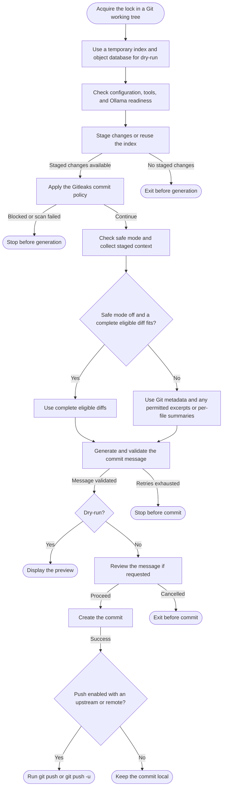

<div align="center">

# Git Auto Commit Ollama

[](https://github.com/aibersemi/git-auto-commit-ollama/actions/workflows/ci.yml)   [](https://saweria.co/aibersemi)

</div>

`git-ai` is a Bash CLI that generates English, scope-free Conventional Commit messages using Ollama. By default it stages repository changes with `git add -A`, scans staged additions with Gitleaks, generates a message, creates the commit, and pushes. Eligible Git change context may reach a local or network Ollama endpoint.

## Table of Contents

- [Features](#features)
- [How It Works](#how-it-works)
- [Quick Start](#quick-start)
- [Documentation](#documentation)
- [Contributing and Support](#contributing-and-support)
- [Support](#support)
- [License](#license)

## Features

- **Flexible staging.** Stage all changes, select hunks interactively, or reuse the existing index. [Staging and commit review](docs/usage.md#staging-and-commit-review)
- **Context-aware generation.** Use complete eligible diffs when they fit the prompt budget, with ranked excerpts and optional per-file analysis for larger changes. [Prompt routing](docs/commit-generation.md#prompt-routing)
- **Message validation.** Validate plain-text or structured responses against the commit format and request corrections when a response is rejected. [Fallbacks and retries](docs/commit-generation.md#fallbacks-and-retries)
- **Secret protection.** Gitleaks can block commits with potential secrets, while safe mode limits the diff context sent to Ollama. [Security controls](.github/SECURITY.md#security-controls)
- **Isolated previews.** Use a temporary index and object database to preview a message while preserving the original index, refs, and stored Git objects. [Dry run](docs/usage.md#dry-run)
- **Commit and push controls.** Review or edit the message before committing and use `--no-push` to keep the commit local. [CLI options](docs/usage.md#options)

## How It Works



The default staging command is `git add -A`. Use `--patch` for `git add -p`. `--no-stage` takes precedence and reuses staged changes. In dry-run, the CLI copies the index if it exists and writes new Git objects to a temporary object database. [Staging](docs/usage.md#staging-and-commit-review) · [Dry run](docs/usage.md#dry-run)

Gitleaks findings and the built-in diff matcher can activate safe mode, which limits the final prompt to Git metadata and any summaries from eligible per-file analyses. The full-diff path requires safe mode to be off and the complete prompt to fit the character budget, including the reserve for corrections. The fallback can analyze eligible files in bounded chunks. [Security overrides](.github/SECURITY.md#overrides) · [Prompt routing](docs/commit-generation.md#prompt-routing)

The terminal estimates AI progress using the number of staged files and shows 100% once the commit message passes validation. [Terminal output](docs/usage.md#terminal-output)

Generation stops after three invalid responses or ten attempts. Use `--interactive` to accept the generated message, edit it, or cancel the commit. With push enabled, a branch with an upstream uses plain `git push`. A branch without an upstream uses `git push -u` with `origin` or the first listed remote, if available. [Generation retries](docs/commit-generation.md#fallbacks-and-retries) · [Push behavior](docs/usage.md#push-behavior-and-hooks)

The generated message starts with a scope-free Conventional Commit subject.

```text
<type>: <summary>
```

For exactly one staged file, the message contains only the subject. For more than one staged file, the message must contain one blank line followed by one to six important bullet points. Accepted types are `build`, `chore`, `ci`, `deps`, `docs`, `feat`, `fix`, `perf`, `refactor`, `revert`, `style`, and `test`.

Paired single-backtick inline code around commands or identifiers is normalized to plain text in both the subject and bullets, for plain-text and structured responses. Unmatched backticks, code fences, other unsupported Markdown, scopes, and invalid bodies still fail validation.

Choose the type that describes the primary change:

| Type | Use when the primary change... |
| --- | --- |
| `build` | Changes the build system, build scripts, compilers, bundlers, packaging, or other build tooling. |
| `chore` | Performs routine maintenance that does not fit another type and does not change product behavior. |
| `ci` | Changes CI/CD workflows, pipeline configuration, or automation scripts used by CI/CD. |
| `deps` | Adds, removes, or updates dependencies or their lockfiles. |
| `docs` | Changes documentation only. |
| `feat` | Adds a new user-facing, API, or domain capability. |
| `fix` | Corrects a bug or unintended behavior. |
| `perf` | Improves performance without changing the intended behavior. |
| `refactor` | Restructures production code without adding a feature or fixing a bug. |
| `revert` | Undoes a previous commit or change. |
| `style` | Changes code formatting, whitespace, or other non-behavioral style details only. |
| `test` | Adds, corrects, or improves tests without changing production behavior. |

If dependency, test, documentation, generated artifact, or configuration changes only support a more important feature or fix, use `feat` or `fix` for the primary change instead of the supporting type.

## Quick Start

Install the [runtime prerequisites](docs/installation.md#prerequisites) and make the configured model available on a [trusted Ollama endpoint](docs/configuration.md#ollama-host-resolution). Clone this project, then change to the Git repository whose changes you want to preview.

```bash
/path/to/git-auto-commit-ollama/git-ai.sh --dry-run --no-pull
```

The preview preserves the original index, refs, and stored Git objects, skips commit and push, and still contacts Ollama. See [Dry Run](docs/usage.md#dry-run) for details. Once the command is [installed](docs/installation.md#install-the-git-ai-command), use `git-ai --interactive --no-push` to review the message before committing locally.

## Documentation

| Guide | Contents |
| --- | --- |
| [Installation](docs/installation.md) | Linux prerequisites, Ollama setup, direct execution, install, and uninstall. |
| [CLI Usage](docs/usage.md) | Commands, flags, staging, dry-run, message review, and push behavior. |
| [Configuration](docs/configuration.md) | Config file precedence, defaults, Ollama endpoints, and worker capacity. |
| [Commit Message Generation](docs/commit-generation.md) | Reference selection, prompt budgets, file analysis, message format, and retries. |
| [Security Policy](.github/SECURITY.md) | Vulnerability reporting, data sent to Ollama, Gitleaks, safe mode, overrides, and debug output. |
| [Troubleshooting](docs/troubleshooting.md) | Diagnose installation, Ollama, staging, scanner, generation, and Git failures. |
| [Architecture](docs/architecture.md) | Runtime flow, components, integration boundaries, and documentation ownership. |
| [Verification](docs/verification.md) | Documentation checks, Bash regression suites, and isolated smoke tests. |
| [Repository Automation](docs/automation.md) | CI, release validation, workflow permissions, and stale issue handling. |

## Contributing and Support

- Follow the [Contributing Guide](.github/CONTRIBUTING.md) and [repository instructions](AGENTS.md) when changing the project.
- Use the [Support Guide](.github/SUPPORT.md) for usage questions, bug reports, and feature requests.
- Report vulnerabilities privately through the [Security Policy](.github/SECURITY.md).

## Support

If this project helps your workflow, you can support it through [Saweria](https://saweria.co/aibersemi). For general usage questions, follow the [Support Guide](.github/SUPPORT.md).

## License

This project uses the [MIT License](LICENSE).
