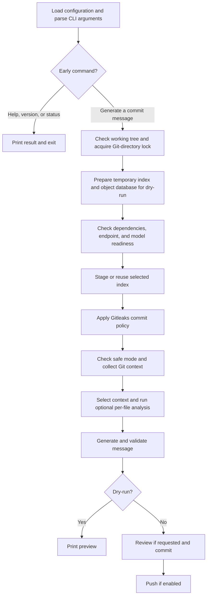

# Architecture

[Documentation index](../README.md#documentation)

`git-ai` is a local Bash CLI executed within a Git working tree. It uses Git for the index, refs, hooks, and remotes, Gitleaks for the commit guard, and a configured Ollama server for message generation. The CLI runs with the caller's filesystem access and Git credentials.

## Runtime Flow

Help and version work outside a Git repository. Status requires a working tree. These commands exit during argument parsing, before the regular dependency checks, repository lock, and Ollama requests. Full runs use `flock` with a lock file under the current Git directory. Linked worktrees have their own Git directories. The main exit handler removes the dry-run workspace and releases the lock after acquisition.

## Integration Boundaries

- **Git.** Context and staged-change policy read the selected index. Ordinary staging, committing, and pushing run sequentially. Independent context reads can run concurrently after the policy decision. See [CLI Usage](usage.md) for the operation boundaries.
- **Gitleaks.** An external process scans staged additions and produces a private JSON report. The CLI validates its result before collecting AI context. See [Gitleaks Commit Guard](../.github/SECURITY.md#gitleaks-commit-guard) for report handling and failure behavior.
- **Ollama.** The CLI is an HTTP client for `/api/tags`, `/api/ps`, and `/api/chat`. Requests run against the [active endpoint](configuration.md#ollama-host-resolution), with readiness checked before staging and analysis and generation performed afterward. See [Commit Message Generation](commit-generation.md#ollama-request-contract) for request and response handling.
- **GitHub Actions.** Repository CI and release publication run separately from the CLI. See [Repository Automation](automation.md) for triggers, permissions, and release validation.

There are no application routes, application accounts, or database. References to APIs, permissions, schemas, and databases in the generation logic help classify changes in the repository being analyzed.

## Repository Map

| Path | Responsibility |
| --- | --- |
| [`git-ai.sh`](../git-ai.sh) | CLI entry point, configuration loading, Git operations, safety checks, Ollama requests, and terminal output. |
| [`git-ai.conf`](../git-ai.conf) | Runtime defaults sourced as Bash code. |
| [`Makefile`](../Makefile) | Help and symlink installation or removal. |
| [`tests/`](../tests/) | Regression coverage for staged references, secret handling, and the installed scanner. |
| [`.github/workflows/`](../.github/workflows/) | CI, release, and stale maintenance. |
| [`AGENTS.md`](../AGENTS.md) | Work rules, Bash conventions, and repository documentation standards. |

## Documentation Ownership

| Information | Canonical guide |
| --- | --- |
| Setup and operating system dependencies | [Installation](installation.md) |
| CLI arguments and Git operation boundaries | [CLI Usage](usage.md) |
| Configuration, endpoint selection, and concurrency settings | [Configuration](configuration.md) |
| Change classification, prompt routing, and message validation | [Commit Message Generation](commit-generation.md) |
| Runtime security controls, exposure limits, and vulnerability reporting | [Security Policy](../.github/SECURITY.md) |
| Symptom-based diagnosis | [Troubleshooting](troubleshooting.md) |
| Local verification and test coverage | [Verification](verification.md) |
| CI, workflow permissions, and release operations | [Repository Automation](automation.md) |
| Contribution process | [Contributing Guide](../.github/CONTRIBUTING.md) |
